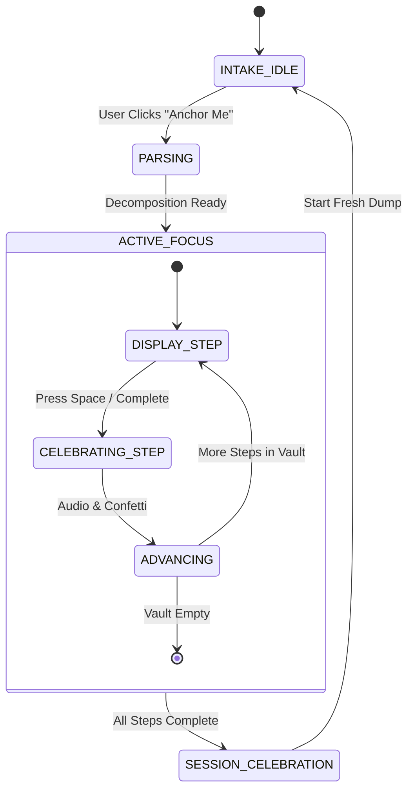
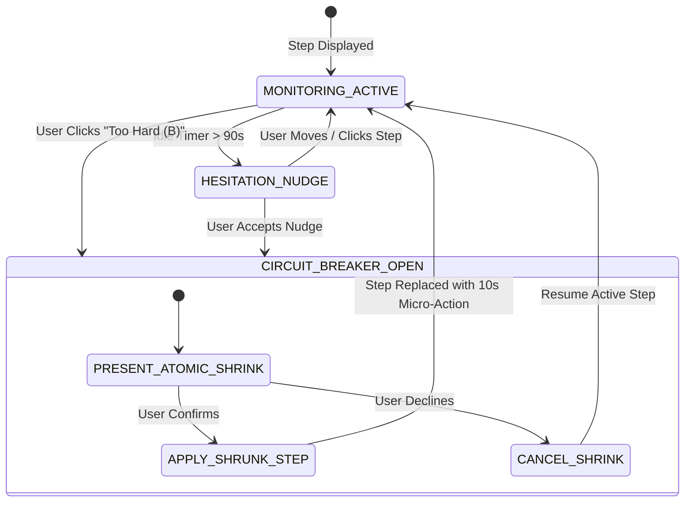

# Anchor — Technical Spec

A technical blueprint for building Anchor: an anti-procrastination cognitive circuit-breaker application that ingests chaotic brain dumps, locks away the background noise, and enforces the Rule of One with avoidance-triggered micro-step breakdown.

---

## How This Works, In Plain Language
Anchor works like a cognitive valve. When a person is frozen by overwhelm, their working memory is saturated with dozens of open loops. 

1. **Intake & Filter**: The user dumps raw thoughts into the app and picks their current energy tier (Low, Medium, High).
2. **Decomposition Engine**: The app breaks those thoughts into microscopic, sequential steps tailored to that energy level.
3. **The Vault & Rule of One**: All subsequent steps are immediately sealed in a background vault. The UI displays strictly **ONE** step in large, calm typography.
4. **Avoidance Monitor**: While the user is on that single step, an avoidance detector monitors activity. If they stall or click *"Too Hard"*, Anchor intervenes with a compassionate circuit-breaker to downscale that specific step into a ridiculously effortless, non-threatening starting action (e.g. *"Just open the tab"*).
5. **Momentum Loop**: As micro-steps are checked off with instant keyboard/audio feedback, dopamine replaces freeze, building unstoppable forward momentum.

---

## The Core Journey Through the System
*PRD ref: [prd.md > The Core Journey](file:///c:/Users/ash76/OneDrive/Desktop/AmazonHackathon-2/prd.md#the-core-journey)*

```
[User Dumps Chaos + Selects Energy] 
                 │
                 ▼
[IntakeContainer] ──► [Decomposition Engine: AI / Heuristic Parser]
                                   │
                                   ▼ (Stores parsed MicroSteps in localStorage)
                        [SessionState: ACTIVE_FOCUS]
                                   │
                                   ▼
                       [RuleOfOneFocusCockpit]
                 ┌─────────────────┴─────────────────┐
                 ▼                                   ▼
          [User Hits Done]                   [Stall / Avoidance Click]
                 │                                   │
                 ▼                                   ▼
        [Audio Chime + Confetti]            [AvoidanceCircuitBreakerModal]
                 │                                   │
                 ▼                                   ▼
    [Next MicroStep Unvaulted]             [Step Shrunk to Atomic Zero]
                 │                                   │
                 └─────────────────┬─────────────────┘
                                   │
                                   ▼
                   [All Done: CelebrationCard]
```

1. User inputs text into `BrainDumpInput` and toggles `EnergySelector`.
2. Submitting dispatches `START_SESSION` with the raw text and energy level to `useAnchorSession`.
3. `breakdownEngine.ts` calls Google Gemini (or deterministic heuristic fallback if offline/no key) to return an ordered array of `MicroStep[]`.
4. `SessionState` sets `activeStepIndex: 0` and transitions to `State.FOCUS`.
5. `FocusCockpit` mounts: only `steps[activeStepIndex]` is rendered. `AvoidanceTimer` begins tracking elapsed seconds on this specific step.
6. If the user completes the step: `COMPLETE_STEP` triggers `audioFeedback.playChime()`, increments `completedCount`, and slides `steps[activeStepIndex + 1]` into view.
7. If `AvoidanceTimer` reaches 90s without action or user presses `B` / clicks *"Too Hard"*, the `AvoidanceModal` opens, offering an "Atomic Zero" breakdown. Accepting it replaces the active step in place with a smaller action.
8. When `activeStepIndex === steps.length`, `SessionState` transitions to `State.COMPLETE` and renders `CelebrationCard`.

---

## Stack
- **Framework**: [Next.js 14/15 (App Router)](https://nextjs.org/docs) with React & TypeScript.
  - *Rationale*: Instant zero-config local development, server/client component flexibility, and bulletproof static build capabilities.
- **Styling**: [Tailwind CSS](https://tailwindcss.com/docs) with `@tailwindcss/typography`.
  - *Rationale*: Rapid, fine-grained control over custom color tokens, dark mode gradients, focus animations, and typography without CSS bloat.
- **Icons**: [lucide-react](https://lucide.dev/)
  - *Rationale*: Lightweight, clean, modern stroke icons for focus states, energy selectors, and vault locks.
- **Micro-Rewards & Audio**:
  - [canvas-confetti](https://www.npmjs.com/package/canvas-confetti): Gentle celebratory particle bursts on milestone completions.
  - **Native Web Audio API**: Zero-dependency synthesized soothing tones (432Hz harmonic chimes) ensuring no external audio assets need to load.
- **AI / Decomposition Engine**:
  - `@google/genai` (or lightweight fetch to Gemini 1.5/2.0 API) with a local deterministic heuristic regex engine as an instant offline fallback.
  - *Rationale*: Guarantees zero downtime or missing API key errors during hackathon evaluations.
- **Persistence**: Browser `localStorage` with `useLocalStorage` synchronization.

---

## Where It Runs and How Someone Tries It
- **Runtime**: Runs locally in any modern browser via Node.js dev server.
- **Start Command**:
  ```bash
  npm run dev
  ```
- **Demo URL**: `http://localhost:3000`
- **Environment**: Optional `NEXT_PUBLIC_GEMINI_API_KEY` in `.env.local`. If absent, the built-in deterministic heuristic decomposition engine seamlessly powers the entire experience.
- **Demo Recording Walkthrough (1 minute)**:
  1. Open `http://localhost:3000`.
  2. Click the quick-preset button *"Hackathon Deadline Panic"*.
  3. Select *"Low / Foggy"* energy.
  4. Click *"Anchor Me"*. Watch the vault close and the Rule of One cockpit emerge.
  5. Demonstrate the Avoidance Circuit Breaker by clicking *"Too Hard / Break It Down"* (or waiting for idle nudge). Show the task shrink.
  6. Press `Space` to complete steps, hear the chimes, observe the momentum streak, and trigger the final celebration.

---

## Look and Feel
*PRD ref: [prd.md > Look and Feel](file:///c:/Users/ash76/OneDrive/Desktop/AmazonHackathon-2/prd.md#look-and-feel)*

- **Color Palette ("Oasis Dark")**:
  - Background Base: `#090d16` (Deepest Void)
  - Surface Card: `#131b2e` (Subtle Midnight Navy)
  - Border Accents: `#1e293b` / `#334155`
  - Primary Text: `#f8fafc` (Ultra-crisp Slate 50)
  - Muted Text: `#94a3b8` (Gentle Slate 400)
  - Accent Brand / Focus Pulse: `#38bdf8` (Electric Sky)
  - Energy Accents:
    - Low: `#f87171` (Warm Terracotta Rose)
    - Medium: `#fbbf24` (Amber Sunlight)
    - High: `#34d399` (Emerald Flow)
- **Typography**: Inter / Outfit for ultra-legible modern headings; tabular monospace for timer displays and keyboard badge prompts.
- **Density**: Extremely spacious and decluttered during focus; high whitespace to lower cognitive blood pressure.

---

## State Machines: Rule of One & Avoidance Detection

### 1. Rule of One State Machine


### 2. Avoidance Detection State Machine


---

## Components

### `AppShell`
- Root layout container. Manages dark theme wrappers, global audio context, and persistent state hydration.
- *PRD ref*: `prd.md > Screens and Layout`

### `BrainDumpIntake`
- Freeform text area for unstructured dumping with one-click demo presets.
- Connects to `EnergySelector` and triggers the parsing transition.
- *PRD ref*: `prd.md > Features and Behavior > 1. Chaotic Brain Dump Intake`

### `EnergySelector`
- Tactile 3-tier segmented toggle (`Low / Foggy`, `Medium / Steady`, `High / Flow`).
- Governs the decomposition prompt and target duration per step.
- *PRD ref*: `prd.md > Features and Behavior > 2. Cognitive Energy Calibration`

### `FocusCockpit`
- Enforces the **Rule of One**. Renders strictly the current `MicroStep` card, keyboard shortcuts banner, and focus pulse.
- *PRD ref*: `prd.md > Features and Behavior > 3. The Rule of One Focus Cockpit`

### `MicroStepCard`
- The focal centerpiece. Shows task verb, concise target, estimated time, and direct completion CTA (`Space`).
- *PRD ref*: `prd.md > Features and Behavior > 3. The Rule of One Focus Cockpit`

### `AvoidanceCircuitBreakerModal`
- Gentle, non-punitive modal that triggers when hesitation is detected or the user clicks "Too Hard".
- Offers an immediate atomic shrink option (halving complexity or turning the first step into a physical 10-second micro-start).
- *PRD ref*: `prd.md > Features and Behavior > 5. Avoidance Detection & The Circuit-Breaker`

### `VaultDrawer`
- Hidden backlog slide-over drawer with a deliberate 1-second friction confirmation to discourage list-skimming while preserving user control.
- *PRD ref*: `prd.md > Screens and Layout > 3. The Vault Drawer`

### `MomentumTracker`
- Visual progress indicator showing completed steps as glowing nodes and session timer.
- *PRD ref*: `prd.md > Features and Behavior > 6. Momentum Engine & Dopamine Micro-Loop`

### `CelebrationCard`
- End-of-session victory card summarizing time invested, micro-steps conquered, and cognitive freeze defeated.
- *PRD ref*: `prd.md > States and Boundaries > Completion State`

---

## Data Model

```typescript
export type EnergyLevel = 'low' | 'medium' | 'high';

export interface MicroStep {
  id: string;
  originalGoal: string;
  actionText: string;
  estimatedSeconds: number;
  isAtomicZero?: boolean; // True if created via avoidance circuit-breaker
  completed: boolean;
  completedAt?: number;
}

export type SessionStatus = 
  | 'idle' 
  | 'parsing' 
  | 'active' 
  | 'avoidance_alert' 
  | 'complete';

export interface AnchorSession {
  id: string;
  rawDump: string;
  energyLevel: EnergyLevel;
  steps: MicroStep[];
  activeStepIndex: number;
  status: SessionStatus;
  startedAt: number;
  completedAt?: number;
  avoidanceIncidents: number;
  audioMuted: boolean;
}
```

---

## File Structure

```
AmazonHackathon-2/
├── app/
│   ├── layout.tsx                # App root layout with fonts & providers
│   ├── page.tsx                  # Primary Anchor page orchestrator
│   └── globals.css               # Tailwind directives & focus glow utilities
├── components/
│   ├── BrainDumpIntake.tsx       # Raw dump input & preset buttons
│   ├── EnergySelector.tsx        # Low / Medium / High segmented control
│   ├── FocusCockpit.tsx          # The Rule of One centerpiece
│   ├── MicroStepCard.tsx         # Active single task display
│   ├── AvoidanceModal.tsx        # "Too Hard? Shrink it" circuit-breaker
│   ├── VaultDrawer.tsx           # Frictioned backlog drawer
│   ├── MomentumTracker.tsx       # Step dots & session clock
│   ├── CelebrationCard.tsx       # Victory card with stats & reset
│   └── AudioToggle.tsx           # Quick chime mute toggle
├── lib/
│   ├── types.ts                  # TypeScript interfaces & state unions
│   ├── breakdownEngine.ts        # AI + deterministic heuristic task parser
│   ├── avoidanceLogic.ts         # Idle timing & task shrink rules
│   ├── audioFeedback.ts          # Web Audio API 432Hz chime synthesizer
│   └── sampleDumps.ts            # One-click demo test cases
├── devpost/
│   ├── learner-profile.md        # Learner onboarding profile
│   ├── scope.md                  # Approved scope specification
│   ├── prd.md                    # Approved product requirements
│   └── spec.md                   # Technical blueprint
├── package.json
├── tailwind.config.js
├── tsconfig.json
└── README.md
```

---

## External Services and Dependencies
- **Next.js & React**: Core web framework.
- **Tailwind CSS & PostCSS**: Utility-first responsive design.
- **Lucide React**: Clean UI iconography.
- **Canvas Confetti**: Lightweight victory particle explosions.
- **Google Generative AI SDK (`@google/genai` or direct Gemini REST endpoint)**:
  - *Endpoint*: `models/gemini-1.5-flash:generateContent`
  - *Payload*: Structured system prompt requesting a JSON array of `MicroStep` objects matching the specified energy tier.
  - *Fallback*: If no API key is provided or network fails, `breakdownEngine.ts` automatically runs a robust local heuristic parsing engine that extracts verbs and generates high-quality micro-steps instantly.

---

## Important Failure Modes
1. **Network or API Key Failure**:
   - *Failure*: Gemini API quota exceeded or no key provided.
   - *Fallback*: Instant local regex & heuristic decomposition engine engages transparently. The user experiences zero interruption or error dialogues.
2. **User Hesitation / Freeze on Micro-Step**:
   - *Failure*: User stares at a task for 90+ seconds without action.
   - *Fallback*: Avoidance detection fires a soothing prompt offering an "Atomic Zero" breakdown to restart momentum.
3. **Accidental Tab Close / Browser Reload**:
   - *Failure*: User refreshes the page mid-focus.
   - *Fallback*: State is continuously synced to `localStorage`. Upon reload, the user immediately resumes at their exact active step.

---

## What Was Simplified and Why
- **Web Audio API Chimes instead of MP3 asset downloads**: Eliminates 404 audio errors, audio codec issues, and asset loading latency.
- **Client-Side Local Storage instead of PostgreSQL/Supabase**: Eliminates authentication setup, database migrations, and connection latency. Perfect for a 60-second hackathon demo.
- **Dual Heuristic + LLM Parser instead of strictly LLM**: Guarantees the app works 100% reliably even offline or during rapid judge evaluations.

---

## Decisions and Open Issues
- **Stack Decision**: Next.js App Router + Tailwind CSS was chosen as requested.
- **Avoidance Threshold**: Set to 90 seconds of idle inactivity on a step (or immediate click on `B` / *"Too Hard"*).
- **Sound Default**: Default ON with a prominent mute toggle in the top-right corner.
